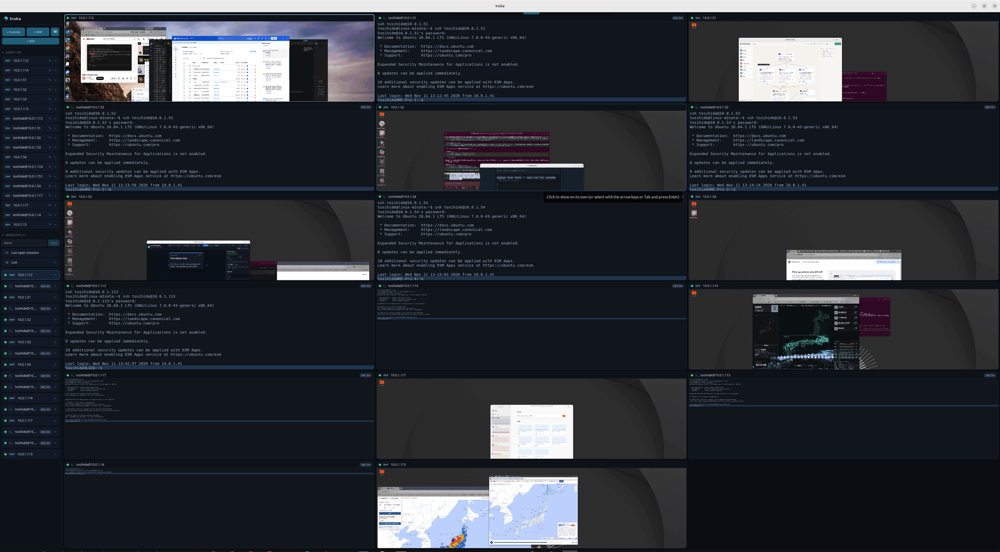

*日本語版: [README_JA.md](README_JA.md)*

# Iruka

A viewer for keeping an eye on many PCs at once. Consoles (SSH and the like) and remote desktops (RDP) are lined up as live thumbnails in a sidebar on the left; click one to show it large on the right. Sessions that are not on screen stay connected and keep running.



https://github.com/user-attachments/assets/c7ae349d-7b1f-41d7-b337-631f762f4ac7

Tauri 2 + React + TypeScript. RDP uses FreeRDP 3 (IronRDP is built in as an experimental fallback).

**Status**: an early, personal-use tool (pre-1.0). Tested with Ubuntu 26.04 LTS as the client, against Windows 11 Pro, Ubuntu GNOME Remote Desktop and macOS on Apple Silicon (macrdp) targets.

## Features

### Consoles

- Open a local shell (rendered with xterm.js).

### Remote desktop (RDP)

- **Targets**: Windows Remote Desktop, GNOME Remote Desktop (screen sharing) on Ubuntu, and a Mac with [clintcan/macrdp](https://github.com/clintcan/macrdp) installed (host is `IP:3390`).
- **Display**: one remote pixel is shown as one screen pixel (1:1). Anything that does not fit is reached by scrolling. The toolbar's "Scaled" button (⤢ / 1:1) instead fits the whole remote screen into the view, scaled down or up as needed, for every RDP session (remembered in `localStorage` key `iruka.scaled`); text is softer that way, so switch back to 1:1 for close work. Thumbnails are always scaled down.
- **Cursor shape**: the cursor over the remote screen takes the shape the remote asks for (resize arrows on window borders, the I-beam over text, a hand over links, hidden while the remote hides it). FreeRDP only; with IronRDP the local arrow is shown.
- **Full screen**: hover the tab at the top centre of the screen and a toolbar slides down. It has "Scaled", "Fullscreen" / "Exit fullscreen", "Disconnect", a "Keep toolbar open" toggle and, for an RDP session, a Print Screen button (⎙, at the far left so it is not hit by accident) that presses the key on the remote, because the local desktop keeps the real key for its own screenshots (KNOWN_ISSUES.md); the screenshot lands in the remote's clipboard. Next to the title it shows memory: the selected session's id with its estimated share for an RDP session (all sessions live in one process, so the usage above the session-free baseline is split by screen size), Iruka as a whole including the WebView, and the machine's RAM.
- **Magnify**: for an RDP session shown on its own, the "100%" button on the toolbar enlarges that session's screen on the Iruka side (100% → 150% → 200% → 100%), for reading small text for a moment. The remote's resolution and scale are not changed and nothing more is sent or received; the part that does not fit is reached with the scrollbars. It applies to that session only and is not remembered. Magnify and "Scaled" exclude each other: magnifying turns "Scaled" off, and turning "Scaled" on puts every session back to 100%. The remote's cursor keeps its own size.
- **Grid view**: "Grid view" on the toolbar lays out every session as 16:9 tiles ("Single view" goes back). The "Columns" slider sets 1 to 6 columns; rows that do not fit scroll vertically. Clicking a tile returns to the single view of that session; the arrow keys, Tab / Shift+Tab (and Home / End) move the highlighted tile and Enter opens it. F11 toggles full screen and Esc leaves it whenever the keyboard focus is not in a session: in the grid, or after clicking the sidebar or an empty area (inside a session those keys go to the remote, so leave it with the view toggle key or a click first). Console tiles carry a badge: "Running", "Idle 5m" or "Exited" (Running = output within the last 2 seconds; spinners such as Claude Code's keep producing output while they work, so this tells you whether a console is waiting for input).
- **Local desktop**: the last tile of the grid (and the last card in the sidebar) is "Local desktop", this computer's own screen, so that it is chosen the same way as a remote one. Choosing it minimizes Iruka as it is, full screen included, with the grid showing; come back with Alt+Tab, the dock or the taskbar and Iruka is where it was. The tile is a placeholder (no picture of the local screen). Choosing from the grid also sets the window state: an RDP session goes full screen, a console is shown in the window (full-screen text is hard to read). Clicking a card in the sidebar leaves the window state alone.
- **Side by side**: an RDP session and one or more consoles can be on show together, chosen in the grid with the keyboard alone (made for typing or dictating into a console while watching a remote screen). In the grid, Space marks or unmarks the selected tile (Ctrl+click does the same; a marked tile gets a green frame and a ✓). Enter or a click on a marked tile shows all the marked sessions, with the keyboard in the one chosen; an unmarked tile opens on its own and the marks stay, so the right Alt key goes back and forth between the grid and the same set. The RDP session is on top and the consoles sit in a row below it; only one RDP session can be marked, and consoles alone are shown next to each other. A set with an RDP session goes full screen. A click moves the keyboard to another pane (its frame is brighter), and the toolbar follows that pane. Three bars adjust the layout, all remembered: the bar between the RDP session and the consoles is dragged up and down, and a double click on it folds the consoles away so that the RDP session has almost the whole window (the bar waits at the bottom; double click or drag it to bring them back; folded consoles keep their size, so the remote programs see no resize); the left and right edge of the console row are dragged sideways to put the consoles in the middle, left or right (double click for the full width).
- **Closing and disconnects**: closing the session on show goes back to the grid in the same window state (full screen stays full screen) instead of showing the next session; only closing the last one leaves full screen. An RDP session that the remote disconnected (or whose automatic reconnect gave up) stays in the list: its tile and sidebar card get a red frame, a "Disconnected" badge and a "Reconnect" button, and the reason is shown over its screen with a "Reconnect" button below it. If it was on show, the view goes back to the grid. Reconnect connects again with the same settings in the same place in the list; the password used for the first connection is kept in memory while Iruka runs.
- **View toggle key**: press and release the right Alt key on its own to switch between the grid and the single view (also in full screen). Hold right Alt and press another key and it is sent to the remote as a normal Alt. Since a lone right Alt no longer reaches the remote, do Alt-only actions (such as focusing the Windows menu bar) with the left Alt. The key can be changed through `localStorage` key `iruka.viewToggleKey` (a `KeyboardEvent.code`, e.g. `ControlRight`). There is no settings screen yet.
- **Connect form**: "Host", "User" and "Password", then the options below, and "Connect" / "Cancel".

  | Option | Meaning | Default |
  |---|---|---|
  | Resolution | "Same as local" / "2560×1440" / "1920×1080". Larger uses more memory | Same as local |
  | Backend | "Auto (FreeRDP first)" / "FreeRDP" / "IronRDP (experimental)". IronRDP has no audio, microphone, clipboard or Low memory, and cannot connect to GNOME Remote Desktop (no RDPGFX) | Auto (FreeRDP first) |
  | Audio | Play the remote's sound locally | Off |
  | Microphone | Send the local microphone to the remote | Off |
  | Low memory | Shrink the RDPGFX cache from 100 MB to 16 MB | On |
  | Clipboard | Share text copy and paste | On |

  Audio, Microphone, Low memory and Clipboard only take effect when connected through FreeRDP.

- **Clipboard (text only)**: copy and paste works in both directions between local and remote. Because many sessions are open at once, only the session on screen is synchronised.
  - **Local → remote**: when the remote screen gains focus, the local text is handed to that session. This happens when you click the remote screen, switch sessions, or come back to Iruka from another application.
  - **Remote → local**: only text copied in the session on screen goes into the local clipboard. Copies in background sessions, or while a console is on screen, are ignored.
  - Windows line endings (CRLF) and Linux line endings (LF) are converted automatically.

- **Memory check**: before connecting, the available memory is compared with an estimate of what the session needs; if there is not enough, a "Memory may run short" dialog appears with "Connect anyway" / "Cancel". The estimate is learned from actual usage. A similar dialog, "This is the local machine", appears when the host turns out to be this PC.
- **Disconnect messages**: when a session ends, the UI shows the reason with the backend name, e.g. "Disconnected (FreeRDP): The server closed the connection" or "Connection error (FreeRDP): Connection failed: …". The backend reasons are "Disconnected", "The server closed the connection", "Connection failed: …" and "Communication error: …".
- **Link health and reconnect** (FreeRDP): a session is kept through a network hiccup. FreeRDP's TCP acknowledgement timeout is raised from its 9 s to 60 s, and when data sent to the remote goes unanswered for 9 s a warning appears over the screen, "No answer from <host> for N s…", counting up until the link recovers (Linux only; the kernel's TCP state is read). If the connection is lost anyway, Iruka reconnects by itself, up to 10 attempts 5 s apart, showing "Connection lost. Reconnecting to <host> (n of 10)…"; a Windows remote resumes the same session. "Disconnect" works at any point. It gives up, with the usual error message, after the 10 attempts, when the server ended the session itself, or when the credentials are refused (retrying could lock the account).

### Saved connections

- **Saved connections**: every connection made from the "+ SSH" or "+ RDP" form is kept in a "Saved" list in the sidebar (`localStorage` key `iruka.profiles`); "Save" stores it without connecting. The optional "Name" is the label shown in the list (the host, or `user@host`, when left empty); connecting again to the same host and user updates the entry instead of adding one. What is saved: SSH: name, host, user and port; RDP: name, host, user and the options (Backend, Audio, Microphone, Low memory, Clipboard, Resolution). Passwords are not kept in this list. With **"Save password"** ticked in the RDP or SSH form, the password goes to the operating system's credential store instead (GNOME Keyring / KWallet through the Secret Service on Linux, the Credential Manager on Windows, the Keychain on macOS), under the connection's id; clicking that saved connection then connects right away. Without it, clicking a saved RDP connection opens the form with everything filled in except the password. Unticking it (or deleting the connection) removes the stored password. "+ SSH" (and clicking a saved SSH connection) opens a console and types `ssh user@host` for you; the host-key fingerprint prompt is answered in the terminal, and so is the password prompt unless a password was given or saved: then Iruka types it at the first prompt ending in "password:" within the first minute, once (a wrong password, key passphrases and the host-key question are left to you). SSH keys remain the better way to log in without a password when you can set them up. "✎" edits an entry and "×" deletes it. The "Saved" header folds the list away (collapsed by default, remembered in `localStorage` key `iruka.savedOpen`).
- **Groups and order of the "Saved" list**: the list is split into an "SSH" and an "RDP" group, each of which folds on its own (remembered), and each group is sorted by name, so the list looks the same on every machine instead of following the order in which the connections were made. Numbers inside names compare as numbers (`10.0.1.51` comes before `10.0.1.113`). The small "A→Z" button beside "Saved" switches to descending order ("Z→A") and back.
- **Worksets**: the "Worksets" section of the sidebar saves the open sessions as a named set (the saved connections they came from, in sidebar order, plus the grid / single view and the column count; plain consoles are not part of it) and brings a set back with one click, also after a restart. "Last open sessions" is written automatically while sessions are open. Restoring starts the sessions one after another (an RDP session gets up to 20 s to connect before the next starts) and only as many RDP sessions as the estimated memory allows, in the saved order; the rest, and RDP connections without a saved password, are listed in the report shown at the end. Sessions already open are kept. Worksets live in `localStorage` (`iruka.worksets`, `iruka.lastWorkset`).

### Security notes

- The client passes `/cert:ignore` to FreeRDP, so server certificates are not verified (the IronRDP backend skips verification too). Use it only on a trusted LAN.
- The password is handed to FreeRDP as an in-process `/p:` argument. It does not show up in the process list, but FreeRDP prints a warning about it; moving to the settings API is planned.
- The connect form is persisted in `localStorage` (`iruka.rdpForm`): Host, User, Backend, Audio, Microphone, Low memory, Clipboard and Resolution. The password is **not** saved there; it is cleared every time the form is loaded. Saved connections (`iruka.profiles`) and worksets hold no password either.
- With "Save password" on, the password is in the OS credential store. For SSH it is typed into the console as keystrokes when ssh asks, so it never appears on a command line or in the process list. On Linux that store is unlocked for the whole login session, so any program running in your session can read it (the same holds for Remmina, Evolution or saved Wi-Fi passwords); lock the screen when you leave. Credential entries are named `dev.tosihide.iruka` with the connection's id as the user field (e.g. visible in GNOME's Passwords and Keys).

## Limitations and known issues

See [KNOWN_ISSUES.md](KNOWN_ISSUES.md).

## Research notes

- [docs/windows-client.md](docs/windows-client.md): running Iruka on Windows in full (prerequisites, FreeRDP via vcpkg, the portable zip, and the step-by-step history with the dead ends). A short build summary is under [Building on Windows](#building-on-windows) below.
- [docs/mac-target.md](docs/mac-target.md): how to use a Mac as a target, and the results of connecting through macrdp (2026-10-13).
- [docs/realtime-kill.md](docs/realtime-kill.md): why Iruka was SIGKILLed under load (WebKitGTK's real-time IPC threads), how it was traced, and the design comparison with Remmina that came out of it (2026-10-23).
- [docs/memory-reduction.md](docs/memory-reduction.md): can a session use less memory? Why a higher compression ratio or more dropped frames would not help, and what would (study, 2026-10-26; nothing implemented).
- [docs/linux-diagnostics.md](docs/linux-diagnostics.md): when Iruka disappears on Linux, how to find out why (exit-status wrapper, journal, bpftrace watch); the trial and error is in [docs/linux-diagnostics-log.md](docs/linux-diagnostics-log.md) (2026-10-24).

## For contributors

- [docs/code-notes.md](docs/code-notes.md): design notes and known weak spots (architecture, threading and the FFI boundary, conventions).
- [TODO.md](TODO.md): open tasks and things still to verify.

## Installing on Linux

Both packages are built on an Ubuntu machine that has the development requirements below. Iruka is a
GTK 3 / WebKitGTK application, so it is not tied to GNOME; it has only been tested on GNOME (Wayland),
and KDE or other desktops are untested.

### Debian package (recommended on Ubuntu)

```sh
scripts/make-deb.sh                          # -> release/iruka_<version>_amd64.deb
sudo apt install ./release/iruka_0.1.3_amd64.deb
```

The package depends on Ubuntu's own FreeRDP 3 (`libfreerdp-client3-3`), WebKitGTK and GTK packages, so
apt installs whatever is missing and keeps FreeRDP updated. It installs `/usr/bin/iruka`, the desktop
entry and the icon.

### Tarball (no installation, no root)

Needs `patchelf` on the build machine:

```sh
scripts/make-tarball.sh                      # -> release/iruka-<version>-linux-x86_64.tar.gz
```

Extract it anywhere and run `./iruka`. The FreeRDP 3 libraries (a copy of Ubuntu's, frozen at the
version on the build machine) are bundled in `lib/` and found through the binary's RPATH (`$ORIGIN/lib`),
so nothing has to be installed or added to `PATH` / `LD_LIBRARY_PATH`. GTK 3, WebKitGTK 4.1 and
FreeRDP's own dependencies are expected from the distribution; an Ubuntu desktop has them all. There is
no dependency check at install time, so if `./iruka` does not start, run `./check-deps.sh`: it lists the
missing libraries and the `apt install` line for them. `./install-desktop-entry.sh` adds Iruka to the
application menu with its icon.

## Development

### Requirements (Ubuntu 26.04)

Build tools and the Tauri 2 / WebKitGTK / FreeRDP development packages (`patchelf` is only needed
for `scripts/make-tarball.sh`; see also the [Tauri prerequisites](https://v2.tauri.app/start/prerequisites/)):

```sh
sudo apt install build-essential pkg-config curl \
  libwebkit2gtk-4.1-dev libgtk-3-dev librsvg2-dev libssl-dev \
  libsoup-3.0-dev libayatana-appindicator3-dev libxdo-dev libdbus-1-dev \
  freerdp3-dev patchelf
```

Node.js and Rust are installed separately, each with its own version manager:

- **Rust** via [rustup](https://rustup.rs/) (`rustup toolchain install stable`)
- **Node.js** via [nvm](https://github.com/nvm-sh/nvm) or your preferred manager (Node 24 or newer)

### Running

```sh
npm install
npm run tauri dev
```

On a Linux desktop the dev build shows a generic dock icon until it is registered once (packaged builds do not need this):

```sh
scripts/install-desktop-entry.sh
```

The RDP diagnostic logs can be filtered with the `IRUKA_LOG` environment variable (e.g. `IRUKA_LOG=iruka_mem=debug`).

## Building on Windows

Windows is a supported client (FreeRDP 3 through vcpkg). This is the short version; the full
procedure, with the dead ends and everything that was checked, is in
[docs/windows-client.md](docs/windows-client.md).

### Prerequisites

- **Visual Studio C++ tools** — "Desktop development with C++"; MSVC compiles the C bridge.
- **vcpkg** — builds FreeRDP 3 and its libraries from the repository's `vcpkg.json` (manifest mode). Either one works:
  1. *You already develop with Visual Studio*: your own vcpkg clone with `VCPKG_ROOT` pointing at it, or Visual Studio's "vcpkg package manager" component (add it in Visual Studio Installer → Individual components if it is missing).
  2. *First build environment, for Iruka*: Visual Studio Community 2026 with "Desktop development with C++" in its default selection already includes it.
- **WebView2** — preinstalled on Windows 11.
- **Git** (Git for Windows).
- **PowerShell allowed to run scripts** — Windows runs no `.ps1` by default, and both `npm` (which
  is `npm.ps1` in PowerShell) and the scripts below fail with "cannot be loaded because running
  scripts is disabled on this system". Run this **once**; it needs no admin and applies to every
  new PowerShell window from then on:

  ```powershell
  Set-ExecutionPolicy -Scope CurrentUser RemoteSigned -Force
  ```

  `RemoteSigned` runs scripts made on this machine or cloned with Git, and stops unsigned scripts
  downloaded through a browser. Check with `Get-ExecutionPolicy` (it should say `RemoteSigned`). If
  you would rather change nothing permanently, run
  `Set-ExecutionPolicy -Scope Process Bypass -Force` instead at the start of **every** window.
- **Node.js** (24 or newer) — the official LTS installer through winget:

  ```powershell
  winget install --id OpenJS.NodeJS.LTS -e
  ```

  This is nodejs.org's own MSI (LTS, 26.x in November 2026). It installs for all users into
  `C:\Program Files\nodejs`, so Windows asks once for administrator approval. Keep to this one
  installation: do not add a second Node.js from nvm-windows, Chocolatey, Scoop or the Microsoft
  Store, or `node` and `npm` may come from different places. The installer's "Tools for Native
  Modules" option is not needed (winget leaves it off). Open a **new** PowerShell afterwards so that
  `Path` includes `node` and `npm`, and check with `node -v` and `npm -v`.
- **Rust** — one command, per user, no admin:

  ```powershell
  winget install --id Rustlang.Rustup -e
  ```

  That is all: it also installs the stable toolchain for `x86_64-pc-windows-msvc`, the toolchain
  Iruka needs, so there is nothing else to install. To check, open a **new** PowerShell (so that
  `Path` includes `cargo`) and run `rustup show`: it should list
  `stable-x86_64-pc-windows-msvc (active, default)`.
- **Smart App Control off** (Windows Security → App & browser control), otherwise the built `iruka.exe` is blocked (os error 4551; see KNOWN_ISSUES.md).
- `ssh.exe` (the preinstalled OpenSSH client) is used for "+ SSH".

### Libraries and environment

From the clone, build the libraries once into `vcpkg_installed\` (10–20 min the first time; the
script finds vcpkg through `VCPKG_ROOT` or Visual Studio, and no restart is needed after installing
Visual Studio):

```powershell
powershell -ExecutionPolicy Bypass -File scripts\windows-deps.ps1
```

Every PowerShell session that builds or runs Iruka then dot-sources `scripts\windows-env.ps1`, which
puts those libraries on `Path` and sets `PKG_CONFIG`, `PKG_CONFIG_PATH` and `OPENSSL_MODULES`, all
relative to the clone.

### Build, run and package

In a native PowerShell, from the clone:

```powershell
. scripts\windows-env.ps1
npm install
.\node_modules\.bin\tauri.cmd dev                              # develop (first build about 7 min)
.\node_modules\.bin\tauri.cmd build --no-bundle                # release exe only, no installer -> src-tauri\target\release\iruka.exe
powershell -ExecutionPolicy Bypass -File scripts\make-zip.ps1  # -> release\iruka-<version>-windows-x64.zip
```

What each line does, if Node.js or Tauri is new to you:

- `npm install` downloads the JavaScript packages listed in `package.json` (React, xterm.js, the
  Tauri command-line tool, …) into `node_modules\` inside the clone. It installs nothing on the
  system; run it again after `package.json` changes.
- `tauri.cmd` is the Tauri command-line tool that `npm install` just put into
  `node_modules\.bin\`; nothing else has to be installed for it.
- `tauri.cmd dev` builds a debug version and starts it; it rebuilds when you change the code.
  Stop it with Ctrl+C.
- `tauri.cmd build` builds the release version. On its own it would then also make installers
  (MSI and NSIS setup.exe); `--no-bundle` means **stop after the exe and make no installer**. It is
  not something to install. Iruka ships a plain zip instead, because Tauri's installers would not
  contain the FreeRDP DLLs.
- `make-zip.ps1` puts `iruka.exe` together with the FreeRDP and OpenSSL DLLs into a zip that runs on
  another Windows machine without any of the above.

`scripts\make-zip.ps1` stages `iruka.exe` with the FreeRDP and OpenSSL DLLs (including `legacy.dll`
for NTLM) and the licence files, then zips the folder. The resulting portable zip runs on another
Windows machine without the development environment; the project ships a plain zip, not an installer.

## License

MIT ([LICENSE](LICENSE))
